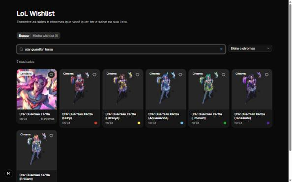

# LoL Wishlist

Wishlist de skins e chromas do League of Legends. Busque qualquer skin ou chroma específico e salve na sua lista para não esquecer o que você quer comprar.

 

## Uso

1. Na aba **Skins**, as skins aparecem separadas por campeão, em ordem alfabética.
2. Para filtrar, digite campeão, skin, chroma ou coleção, em qualquer ordem (ex.: `ahri arcana`, `kaisa esmeralda`). Acentos e apóstrofos não importam, e os nomes em inglês também funcionam (`arcade ahri` encontra Ahri Fliperama).
3. Clique numa skin para ver a splash art e todos os chromas dela.
4. Toque no ♥ de uma skin ou de um chroma para adicionar ou remover da wishlist.
5. Veja tudo na aba **Minha wishlist**, também agrupado por campeão.

Por enquanto a wishlist fica salva no navegador (`localStorage`). Login e sincronização entre dispositivos estão no plano.

## Como funciona

- A API oficial da Riot não tem dados de skins nem chromas. Os dados e as imagens vêm do [CommunityDragon](https://www.communitydragon.org/), que espelha os arquivos do client do LoL.
- Os nomes vêm em português do Brasil (pasta `pt_br` do CommunityDragon). Os nomes em inglês são guardados só para a busca.
- O servidor junta `skins.json`, `champion-summary.json` e `skinlines.json` num catálogo enxuto, guardado em cache por até um dia (`use cache` + `cacheLife("days")`).
- `GET /api/skins?cursor=0&q=ahri` devolve **8 campeões por vez**, já filtrados pela busca. A tela carrega a próxima página quando você chega perto do fim (scroll infinito com `IntersectionObserver`).
- A busca espera 300 ms depois da última tecla (debounce), para não disparar um request por letra.
- `GET /api/skins/items?keys=s1013,c1014` resolve os itens salvos na wishlist, que podem não estar nas páginas já carregadas.

## Stack

- [Next.js 16](https://nextjs.org/) (App Router) + TypeScript
- [Tailwind CSS](https://tailwindcss.com/) + [shadcn/ui](https://ui.shadcn.com/)
- Próximos passos: [Supabase](https://supabase.com/) (login + banco) e deploy na [Vercel](https://vercel.com/)

## Build

Requer Node.js. Para rodar em modo de desenvolvimento (abre em `http://localhost:3000`):

```bash
npm install && npm run dev
```

Para gerar e rodar a versão de produção:

```bash
npm run build && npm start
```

---

LoL Wishlist não é endossado pela Riot Games e não reflete as opiniões da Riot Games nem de ninguém oficialmente envolvido na produção ou gestão das propriedades da Riot Games. Riot Games e todas as propriedades associadas são marcas comerciais ou registradas da Riot Games, Inc.
